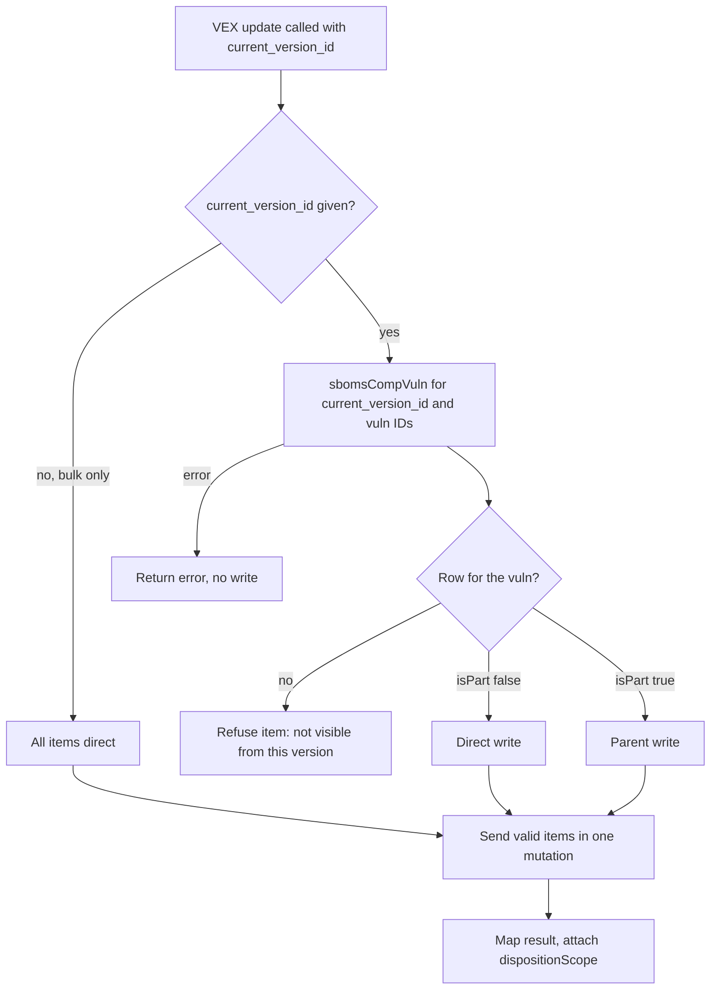

# Parent VEX Dispositions and Parent/Child Version Links - Plan

## Goal Capsule

- **Objective:** A client of lynk-mcp (Claude, Codex) can set a VEX status for a vulnerability as seen from a parent version, and can discover which versions are parents and children of which, without being told that the capability exists.
- **Means:** The existing VEX update tools choose between a direct change and a parent-level change themselves (KTD1), backed by a new read-only version-relations tool.
- **Authority:** The Product Contract wins on behavior. KTDs win on mechanism. Units override neither.
- **Closes:** interlynk-io/lynk-mcp#56 (parent/child links) and #57 (500 on parent-level VEX update).
- **Stop conditions:** Stop and ask if live API behavior contradicts KTD2 (see Open Questions). Do not change `lynk-api`.
- **Execution profile:** Go module. Work on branch `fix/update-component-vex-parent-disposition-57`. Tests first for the dispatch units (U3, U4, U5).

---

## Product Contract

### Summary

lynk-mcp gets one new read-only tool, `get_version_relations`, that lists a version's parents and children. `update_component_vex` and `bulk_update_component_vex` check how the given `current_version_id` relates to each vulnerability. They write directly when the version owns the vulnerability, write a parent-level disposition when the version is an ancestor of the owner, and refuse otherwise. Results state which kind of write happened.

### Problem Frame

A vulnerability lives in one version (SBOM). A parent version that includes it as a part can hold its own status for it, stored as a `DispositionByParent` record in the API. The API creates that record whenever `current_version_id` differs from the owning version, without checking that the two are related.

lynk-mcp hides this. Its tool descriptions never mention parent-level writes, no tool shows parent/child links, and a parent-level write returned a 500 (the response asked for a field the parent-level record lacks). #57 covers the 500 and the missing explanation. #56 covers the missing links. A user had to ask for the parent-level write explicitly, and a typo in `current_version_id` would silently write a parent-level record for an unrelated version.

### Requirements

**Version links**

- R1. `get_version_relations` takes a version ID and returns that version's parents and children, each with version ID, version string, and product name and ID.
- R2. Parents are all ancestors the API reports. Children are direct children by default, and all descendants when `deep` is true.

**Choosing direct or parent**

- R3. `update_component_vex` determines, per call, whether `current_version_id` owns the vulnerability (direct write) or is an ancestor of its owner (parent write).
- R4. When the vulnerability is not visible from `current_version_id`, no write happens. The error lists the possible causes (wrong vulnerability ID, vulnerability retracted or hidden, or the version is neither the owner nor an ancestor of the owner) and names `get_version_relations`.
- R5. When the relation check itself fails, no write happens.

**Reporting**

- R6. Every VEX update result carries `dispositionScope` (`direct` or `parent`). A parent write also carries `parentVersionId` and `ownerVersionId`.

**Bulk**

- R7. `bulk_update_component_vex` decides direct or parent per vulnerability. Vulnerabilities that fail the check are reported as individual errors with their IDs. The rest are sent in one API call. Each updated item carries its own scope fields.
- R8. When bulk `current_version_id` is omitted, every item is a direct write and no relation check runs.

**Discoverability**

- R9. The descriptions of `update_component_vex`, `bulk_update_component_vex`, and `get_version_relations` explain direct versus parent writes and point to each other. They use the terms "direct" and "parent" consistently.

### Key Decisions

- **No separate parent-disposition tool.** The two VEX tools decide the path. Governs R3, R7. (session-settled: user-directed — chosen over a `set_parent_disposition` tool and over description-only guidance: the user asked for code-level choice and told us to drop the parent tool.)
- **Refuse unrelated parents.** Governs R4. (session-settled: user-approved — chosen over passing any version through to the API: the typo risk was surfaced and the user approved the check.)
- **Bulk decides per vulnerability.** Governs R7. (session-settled: user-approved — chosen over one scope for the whole call.)

### Success Criteria

- A fresh Claude session given only "in my-application, set CVE-2022-2274 on the nodejs openssl to In Triage" completes the update without extra guidance and reports it as a parent write.
- A wrong `current_version_id` produces a refusal and no record.

### Scope Boundaries

- Out: any change to `lynk-api`, including the `vuln_id` delegate the user already added.
- Out: renaming existing tools or parameters (breaking for current clients).
- Out: other parent-level features (external URLs on dispositions, custom CVSS).
- Out: a parent-aware read of VEX status per version.

---

## Planning Contract

### Key Technical Decisions

- KTD1. **Dispatch lives in the API client, not in a new tool.** `UpdateComponentVex` and `BulkUpdateComponentVex` in `internal/api` call the scope check, return a typed refusal and scope fields, and send the mutation. The handlers in `internal/mcp` only format results and errors. The `lynkClient` interface gains no new method for this. The two VEX tools keep their names and inputs. See Key Decisions for the owner of this choice. (session-settled: user-directed — chosen over a `set_parent_disposition` tool: user asked for it.)
- KTD2. **Scope comes from the API's `sbomsCompVuln` query.** Called with `sbomIds: [current_version_id]` and the vulnerability IDs, it returns the rows visible from that version. A returned row with `isPart` false means direct. A returned row with `isPart` true means parent. The row's `sbomId` is the owning version, which fills `ownerVersionId`. No row means "not visible from this version", which has several causes: the ID is wrong, the vulnerability is retracted with no VEX status (the finder hides it and the query has no argument to change that), or the version is unrelated. Duplicate rows from diamond-shaped hierarchies are deduplicated by ID. This replaces an owner lookup, which the API cannot do (it has no root query for one vulnerability by ID). One call covers a whole bulk request.
- KTD3. **Fail closed.** If the check errors, the tool returns the error and sends no mutation (R5).
- KTD4. **Naming.** The new tool is `get_version_relations`, following `get_version` and `get_component`. Result fields are `dispositionScope`, `parentVersionId`, `ownerVersionId`. The existing parameter `current_version_id` and both VEX tool names stay, because renaming them breaks clients. Its description changes instead.
- KTD5. **Bulk partitions before the API call.** The API applies a bulk request in one transaction and rolls the whole batch back on the first failure. Per-item refusal therefore happens in lynk-mcp, before the call. After the call, an API error applies to every item sent.
- KTD6. **Keep selecting `vulnId` in both VEX mutations.** The 500 is fixed in `lynk-api` by `delegate :vuln_id, to: :component_vuln` on `DispositionByParent`. The MCP-side workaround of dropping `vulnId` is not carried forward.
- KTD8. **Accept the retracted-vulnerability gap.** A vulnerability that is retracted with no VEX status, or a part with no disposition record yet, is "not visible" and is refused with the R4 message. No second lookup is added. (session-settled: user-directed — chosen over a second owner lookup and over skipping the check for the owner version: the user picked the no-new-API-work option after the cost of each was surfaced.)
- KTD7. **Relations come from `connectedSboms`, `sbomParts`, and `deepParts`** on the version type. They already exist in the API.

### High-Level Technical Design

Decision flow shared by both VEX tools (authoritative alongside the prose):

### Assumptions

- `sbomsCompVuln` covers all descendants, exposes `isPart`, and returns the underlying component vulnerability `id` for part rows. Source inspection of `lynk-api` (`SbomVulnsFinder`, `ComponentVulnType`) supports this; U3 keeps a live smoke check.
- The test org holds `my-application` with children `libcrypto` and `nodejs`, as issue #56 reports.

### Risks and Dependencies

| Risk | Mitigation |
|---|---|
| A retracted vulnerability with no VEX status, or a part with no disposition record yet, returns no row, so a first-time status from its owning version could be refused. | Accepted gap (KTD8). Word the refusal to name this cause (R4) and say so in the tool descriptions. |
| Live behavior differs from the source reading in the Assumptions. | U3 smoke check against the live API; stop condition in the Goal Capsule. |
| Older `lynk-api` without the `vuln_id` delegate still returns the 500. | Document the minimum API in the tool description and the testing checklist (U6). |
| Behavior change: a parent write for an unrelated version used to succeed and is now refused. | Intended (R4). State it in the PR description. |
| One extra API call per update. | Acceptable. Bulk uses one call for all items. |
| API rollback applies to the whole sent batch (KTD5). | Return the API error unchanged and list which items were sent. |

### Open Questions

- Deferred: confirm in U3 with a live call that retracted vulnerabilities, vulnerabilities with no disposition record yet, and diamond-shaped hierarchies behave as the source suggests.

---

## Implementation Units

| Unit | Title | Depends on |
|---|---|---|
| U1 | Version relations query and API wrapper | none |
| U2 | `get_version_relations` tool | U1 |
| U3 | VEX scope check | none |
| U4 | Dispatch in `update_component_vex` | U3 |
| U5 | Dispatch in `bulk_update_component_vex` | U3, U4 |
| U6 | Descriptions, checklist, branch cleanup | U2, U4, U5 |

### U1. Version relations query and API wrapper

- **Goal:** Fetch a version's parents and children from the API.
- **Requirements:** R1, R2
- **Dependencies:** none
- **Files:** `internal/graphql/queries.go`, `internal/api/versions.go`, `internal/api/versions_test.go`
- **Approach:**
  - Add a query selecting `connectedSboms`, and `sbomParts` or `deepParts` depending on a `deep` variable, each with version ID, version string, and project ID and name (KTD7).
  - Add a `GetVersionRelations` client method returning parents and children lists.
- **Patterns to follow:** `GetVersion` in `internal/api/versions.go` and its fake GraphQL executor tests.
- **Test scenarios:**
  - Version with two parents and one child maps all fields.
  - Version with no relations returns two empty lists, not nil errors.
  - `deep` true selects descendants instead of direct children.
  - GraphQL error is returned unchanged.
- **Verification:** `go test ./internal/api` passes; the query string contains the three relation fields.

### U2. `get_version_relations` tool

- **Goal:** Expose U1 as a read-only MCP tool.
- **Requirements:** R1, R2, R9
- **Dependencies:** U1
- **Files:** `internal/mcp/server.go`, `internal/mcp/tools.go`, `internal/mcp/tools_test.go`
- **Approach:**
  - Add the method to the `lynkClient` interface and the fake client.
  - Register `get_version_relations` with `version_id` (required) and `deep` (optional).
  - Description states what parents and children are and that it helps choose `current_version_id` for VEX updates.
- **Patterns to follow:** `handleGetVersion` and its registration.
- **Test scenarios:**
  - Missing `version_id` returns a parameter error.
  - Valid call formats `parents` and `children` with product and version identifiers.
  - `deep` is passed through to the client.
- **Verification:** Tool appears in the tool list; handler tests pass.

### U3. VEX scope check

- **Goal:** Classify each vulnerability as direct, parent, or unrelated for a given version (KTD2, KTD3).
- **Requirements:** R3, R4, R5
- **Dependencies:** none
- **Execution note:** Start with a live smoke call to `sbomsCompVuln` against the test org (retracted, no-disposition, and diamond cases from the Open Questions). Then write tests first.
- **Files:** `internal/graphql/queries.go`, `internal/api/vex_scope.go`, `internal/api/vex_scope_test.go`
- **Approach:**
  - Add the `sbomsCompVuln` query selecting `id`, `isPart`, and `sbomId`, and a `ResolveVexScope` method taking a version ID and vulnerability IDs.
  - Return per ID the scope (direct, parent, or not visible) and, for found rows, the owning version ID from `sbomId`. Deduplicate rows by ID.
  - Errors are returned, never mapped to a scope.
- **Test scenarios:**
  - Row with `isPart` false maps to direct.
  - Row with `isPart` true maps to parent and carries the owner version ID.
  - ID with no row maps to not visible.
  - Duplicate rows for one ID collapse to one scope.
  - Mixed batch returns one scope per ID.
  - GraphQL error returns an error and no scopes.
- **Verification:** `go test ./internal/api`; open question answered in the PR description.

### U4. Dispatch in `update_component_vex`

- **Goal:** Make the single update choose direct or parent, refuse unrelated versions, and report scope.
- **Requirements:** R3, R4, R5, R6, R9
- **Dependencies:** U3
- **Files:** `internal/api/mutations.go`, `internal/mcp/tools.go`, `internal/mcp/server.go`, `internal/api/mutations_test.go`, `internal/mcp/tools_test.go`
- **Approach:**
  - In `UpdateComponentVex`, call `ResolveVexScope` before the mutation (KTD1). "Not visible" returns a typed refusal with the R4 message. A check error returns an error (KTD3).
  - Add scope fields to the update result and format them in the handler (KTD4). The stash `vex-parent-disposition fix` holds an earlier version of the result marker and description wording; reuse its wording with the KTD4 names and drop the stash after. Keep `vulnId` selected (KTD6).
  - Rewrite the single-update tool and `current_version_id` descriptions (R9).
- **Patterns to follow:** `handleUpdateComponentVex`; `TestUpdateComponentVex_MapsInputsAndResults`.
- **Test scenarios:**
  - Owner version: mutation sent, result `dispositionScope` direct.
  - Parent version: mutation sent, result `parent` with `parentVersionId` and `ownerVersionId`.
  - Vulnerability not visible from the version: no mutation sent; error lists the causes and names `get_version_relations`.
  - Scope check errors: no mutation sent.
  - `confirm` missing: unchanged refusal.
- **Verification:** `go test ./internal/api ./internal/mcp`; fake GraphQL executor records zero mutation requests in the refusal cases.

### U5. Dispatch in `bulk_update_component_vex`

- **Goal:** Apply the same decision per vulnerability in bulk.
- **Requirements:** R4, R5, R6, R7, R8, R9
- **Dependencies:** U3, U4
- **Files:** `internal/api/mutations.go`, `internal/mcp/tools.go`, `internal/mcp/server.go`, `internal/api/mutations_test.go`, `internal/mcp/tools_test.go`
- **Approach:**
  - When `current_version_id` is set, resolve scopes for all IDs in one call (KTD2), partition into valid and refused (KTD5), send valid IDs in one mutation, and merge refusals into `errors` with vulnerability IDs. Use the same refusal wording and typed error as U4.
  - When `current_version_id` is absent, skip the check (R8).
  - Attach scope fields to each returned item.
  - Rewrite the bulk tool and `current_version_id` descriptions (R9). Say that an API error applies to every item sent.
- **Test scenarios:**
  - All items direct: one mutation with all IDs.
  - Mixed direct and parent: one mutation, each item carries its own scope.
  - One not-visible ID: mutation sent without it; `errors` names it.
  - All not visible: no mutation; errors list every ID.
  - Scope check errors: no mutation sent; error returned.
  - `current_version_id` omitted: no scope call, all items direct.
  - API returns an error: error returned and the sent IDs are listed.
- **Verification:** `go test ./internal/api ./internal/mcp`; recorded mutation variables contain only valid IDs.

### U6. Descriptions and checklist

- **Goal:** Make the feature discoverable and testable by hand.
- **Requirements:** R9
- **Dependencies:** U2, U4, U5
- **Files:** `internal/mcp/server.go`, `docs/mutation-tools-testing.md`
- **Approach:**
  - Check that the three tool descriptions use "direct" and "parent" consistently and cross-reference each other.
  - Add rows to the mutation testing checklist for a parent write, a refused unrelated write, and `get_version_relations`, using the nodejs, libcrypto, and my-application test data. State the minimum `lynk-api` requirement (KTD6).
- **Test expectation:** none -- documentation; covered by U2, U4, U5 tests.
- **Verification:** `make ci` passes.

---

## Verification Contract

| Check | Command or step | Covers |
|---|---|---|
| Format and vet | `make fmt`, `make vet` | all units |
| Unit tests | `make test` | U1-U5 |
| Full CI target | `make ci` | all units |
| Live: relations | Run `get_version_relations` on my-application; expect libcrypto and nodejs as children | U2 |
| Live: parent write | Set CVE-2022-2274 on the nodejs openssl to In Triage with `current_version_id` = my-application; expect `dispositionScope` parent and no 500 | U4 |
| Live: refusal | Same call with an unrelated version; expect refusal and no new record | U4 |
| Live: fresh session | In a new client session, say "in my-application, set CVE-2022-2274 on the nodejs openssl to In Triage"; expect a parent write with no extra guidance | R9, Success Criteria |
| Live: bulk mix | One direct and one parent vulnerability in one call; expect per-item scope | U5 |

## Definition of Done

- All R1-R9 satisfied; each unit's verification passes.
- `make ci` is green.
- Live checks in the Verification Contract pass against the test org, or any gap is stated in the PR.
- The U3 smoke check result is recorded in the PR description.
- No abandoned-attempt code remains in the diff.
- The PR description closes #56 and #57 and notes the refusal behavior change.
